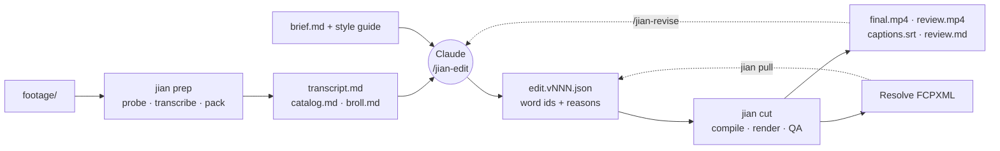

# jianji

**剪辑 (jiǎnjí) means "video editing" in Chinese; `jian` (剪) means "to cut".**

Built by [Mauri Ruiz](https://www.youtube.com/@mauri_ruiz) for his YouTube channel.

> **Status: early alpha (v0.1).** Built for my own workflow on macOS / Apple Silicon. Expect rough edges;
> [issues](https://github.com/mauriruiz/jianji/issues) welcome.

jianji makes the first cut of your videos on your own Mac. Drop the raw footage in a folder, run `/jian-edit` in
Claude Code, and get back an edited video with captions, a review render with timecodes, a QA report and a
DaVinci Resolve timeline you can finish by hand.

It's for people who film themselves: talking-head explainers, vertical shorts, long coding livestreams. You stay the
editor-in-chief: Claude makes the cuts a good assistant would make and explains each one, and you review, give
feedback in plain words ("S4 drags", "move the example earlier") or open it in Resolve.

## Demo

[▶ Watch the demo on YouTube](https://youtu.be/DxpFm1cX5NA)

This video was cut by jianji from a 6-hour livestream and then reviewed by me.

## How it works



- **Claude edits, a deterministic CLI does the rest.** Claude reads compact text views (about 1 KB of transcript
  per minute of speech) and writes an edit that picks speech by word id, never by timestamp. The `jian` CLI turns
  that into frame-exact cuts, renders, and checks the result. The CLI never calls a language model.
- **Cuts that sound natural.** jianji aims to cut only at clause or sentence ends and keep real silence at every
  cut, drop fillers and retakes, and never flash anything on screen for under a second; QA flags cuts that don't.
- **QA on every render**: clipped words, cuts through speech, text over faces, captions, loudness, A/V sync, safe
  zones for shorts, secrets on screen for streams. `fail` means a confirmed problem.
- **Resolve round trip**: every cut is also an FCPXML timeline on your original footage; the import is tested on
  Resolve 21.2 (free). Edit it, export, and `jian pull` brings your changes back as the next version. `jian pull` is
  **experimental**: it's tested on jian's own FCPXML, not yet on a real export from Resolve.

- **Shorts out of a stream**: `/jian-shorts <name>` picks the moments and cuts each as a vertical short, the camera
  over the screen (two regions of the recording you name once), with a light preview and its own Resolve timeline.
  `jian queue` lists the candidates; `jian approve <id>` puts one in your upload folder as a Resolve project on the
  original recording. jian never renders the final file of an approved short and never publishes anything.
  See [docs/STREAMING.md](docs/STREAMING.md).

More in [docs/ARCHITECTURE.md](docs/ARCHITECTURE.md).

## Requirements and limits

- **macOS on Apple Silicon only.** Transcription and the vision model run on MLX; text placement and OCR use Apple
  Vision. Developed and tested on an M1 Max with 32 GB of RAM.
- **Claude Code**, with a Claude subscription or API access. The editing happens in Claude Code sessions.
- **Homebrew `ffmpeg-full`** (the build with libass, for burned-in captions) and the Xcode command line tools.
- **About 10 GB of local models**, downloaded on first use: Whisper large-v3-turbo, wav2vec2 aligners, Qwen3-VL-8B.
- **Disk**: jian refuses to start a stage that would leave less than 20 GB free (configurable).
- **DaVinci Resolve** (free or Studio) is optional.
- **Languages**: English and Spanish are tested, including videos that mix both. Other languages Whisper supports
  should work but are untested. Overlapping speakers transcribe worse; there's no speaker diarization yet.
- It makes a first cut, not a finished film: no music, no color grading, no motion graphics.

## Quickstart

```sh
brew install uv ffmpeg-full
xcode-select --install                      # if you don't have the command line tools yet
git clone https://github.com/mauriruiz/jianji && cd jianji
uv tool install --editable .                # installs `jian` in ~/.local/bin
uv tool update-shell                        # puts ~/.local/bin on your PATH; then open a new terminal
mkdir -p ~/.claude/skills
ln -s "$PWD/.claude/skills/jian-edit" "$PWD/.claude/skills/jian-revise" ~/.claude/skills/
mkdir -p ~/.config/jianji
printf 'schema = 1\nvideos_root = "~/Movies/jianji"\n' > ~/.config/jianji/config.toml
mkdir -p ~/Movies/jianji
jian doctor                                 # checks the install (in the new terminal)
```

Then, for each video:

1. `jian new my-video --profile explainer` (or `short`, `stream`) creates `~/Movies/jianji/my-video/` with a
   `footage/` folder and a commented `brief.md`. Copy your files into `footage/`; they are never modified.
2. In Claude Code: `/jian-edit my-video`. The first run downloads the models. Claude transcribes, plans the story,
   writes the edit, renders and checks it, and writes `jianji/review.md`.
3. Watch `jianji/renders/review.vNNN.mp4` (timecodes and section ids burned in). Give feedback with
   `/jian-revise my-video "S2 is too long; keep the joke at 3:10"`.
4. Upload `jianji/renders/final.vNNN.mp4`, or finish it in Resolve: [docs/RESOLVE.md](docs/RESOLVE.md).

Filming habits that save editing time (say "retake" to redo a sentence, "mark that" for a highlight):
[docs/SHOOTING.md](docs/SHOOTING.md). For livestreams: [docs/STREAMING.md](docs/STREAMING.md).

## An example brief

```markdown
---
profile: explainer
language: en
target_length: 8-10 min
glossary: Kubernetes, Ana García
must_keep: the cost comparison
---

# Brief: why we left microservices

## What it's about
We merged eight services back into one: what it cost, what we gained, and when you shouldn't do it.

## Audience
Backend developers who know what a microservice is.

## Notes
Open on the outage story. B-roll of the whiteboard for the architecture part.
```

Every field is optional; without a brief Claude infers what it can and lists its assumptions in review.md.

## Your layer: settings that survive updates

jian reads its built-in profiles and style guides, then your layer in `~/.config/jianji/`, then the video's own
settings. Keep your preferences in your layer (a private git repo works well), never in the code:

```
~/.config/jianji/
  config.toml           schema = 1, videos_root, [defaults] for every profile, [ingest] for recordings,
                        [hooks] to run your own command on an event, [layouts] and [outro] for shorts,
                        [queue] for the folder approved shorts go to
  profiles/short.toml   only the keys you change ([cut] max_pause = 0.3), or a whole new profile
  styles/short.md       your editorial rules for that profile (replaces the built-in guide)
  brand.toml            your fonts and colours
  glossary.txt          names you say often, one per line
  briefs/default.md     your brief template for `jian new`
  extensions/show.toml  settings for a series, used by `extends: show` in a brief
```

`jian doctor` checks your layer against the installed version and explains what to change when the format does.

## Privacy

Your media stays on your machine: transcription, alignment, the vision model, rendering and QA run locally. What
goes to Claude is text (transcripts, catalogs, notes, the edit) and a few still frames at decision points (contact
sheets, a frame at a cut). Nothing is uploaded anywhere else.

## Security

- **Footage is untrusted input.** What's said or shown in a video (a stream's public chat, a slide, a file on screen)
  reaches Claude as text. The skills treat it as material, never as instructions, but **don't run `/jian-edit` with
  auto-accept** (accept-all mode or `--dangerously-skip-permissions`) on footage you don't fully control, such as a
  stream with public chat: let Claude Code ask before it runs anything.
- **Model downloads are pinned.** Every Hugging Face model is downloaded at an exact commit, as safetensors, and no
  pickle file is fetched from those repos. The Spanish, French, German and Italian aligners only publish a pickle,
  so jian uses Hugging Face's own safetensors conversions of them (the Spanish one checked identical to the
  original).
- **What still loads through pickle:** the English aligner (wav2vec2 base 960h), which torchaudio downloads from
  download.pytorch.org as a `.pth` file. Silero VAD is a TorchScript file bundled inside the silero-vad package.
- **PyTorch 2.8.** whispermlx pins it, and 2.8 has published advisories about loading untrusted checkpoint files and
  malformed input to specific functions. jian never loads a checkpoint you or anyone else supplies, only the models
  above; it moves to a fixed PyTorch as soon as whispermlx allows.
- Found a vulnerability? Report it privately: [SECURITY.md](SECURITY.md).

## Development

```sh
uv sync
uv run pytest                    # fast suite, no models needed
JIANJI_SLOW=1 uv run pytest      # everything, with the local models
```

See [CONTRIBUTING.md](CONTRIBUTING.md).

## Acknowledgements

jianji learned from these projects. No code or text was copied from the non-commercial ones; ideas and rules are
restated in our own words.

- [browser-use/video-use](https://github.com/browser-use/video-use) (MIT): the packed transcript as the model's view,
  cached transcripts, a capped self-review loop, two-pass loudness normalization.
- [barefootford/buttercut](https://github.com/barefootford/buttercut) (PolyForm Noncommercial): contact sheets as
  "visual transcripts", and how Resolve links FCPXML media.
- [appariciojunior/video-editor-skills](https://github.com/appariciojunior/video-editor-skills) (CC BY-NC 4.0):
  cutting from words rather than volume, pause lengths by pace, "unsure: keep it and flag it", spoken notes to the
  editor as markers.
- [Forward-Future/alexs-davinci-editing-skills](https://github.com/Forward-Future/alexs-davinci-editing-skills)
  (MIT): centered audio crossfades at cuts.
- [poseljacob/agentic-video-editor](https://github.com/poseljacob/agentic-video-editor) (MIT): a separate reviewer
  that scores the render.
- [liuluhaixiu/DaVinci-AutoEdit-Agent](https://github.com/liuluhaixiu/DaVinci-AutoEdit-Agent) (MIT): the "next
  time, film this" report.
- [FireRedTeam/FireRed-OpenStoryline](https://github.com/FireRedTeam/FireRed-OpenStoryline) (Apache-2.0):
  reusable per-style guides.
- [HKUDS/VideoAgent](https://github.com/HKUDS/VideoAgent) (MIT): plan the sections before picking ranges.
- [WyattBlue/auto-editor](https://github.com/WyattBlue/auto-editor) (Unlicense),
  [whispermlx](https://pypi.org/project/whispermlx/) (BSD-2), [JeremySNR/cutawan](https://github.com/JeremySNR/cutawan)
  and [KazKozDev/auto-vertical-reframe](https://github.com/KazKozDev/auto-vertical-reframe) (MIT).

## License

Apache-2.0. See [LICENSE](LICENSE), and [NOTICE](NOTICE) for the third-party software and models jianji uses but
doesn't include.

jianji is an independent project, not affiliated with Anthropic or Blackmagic Design.
